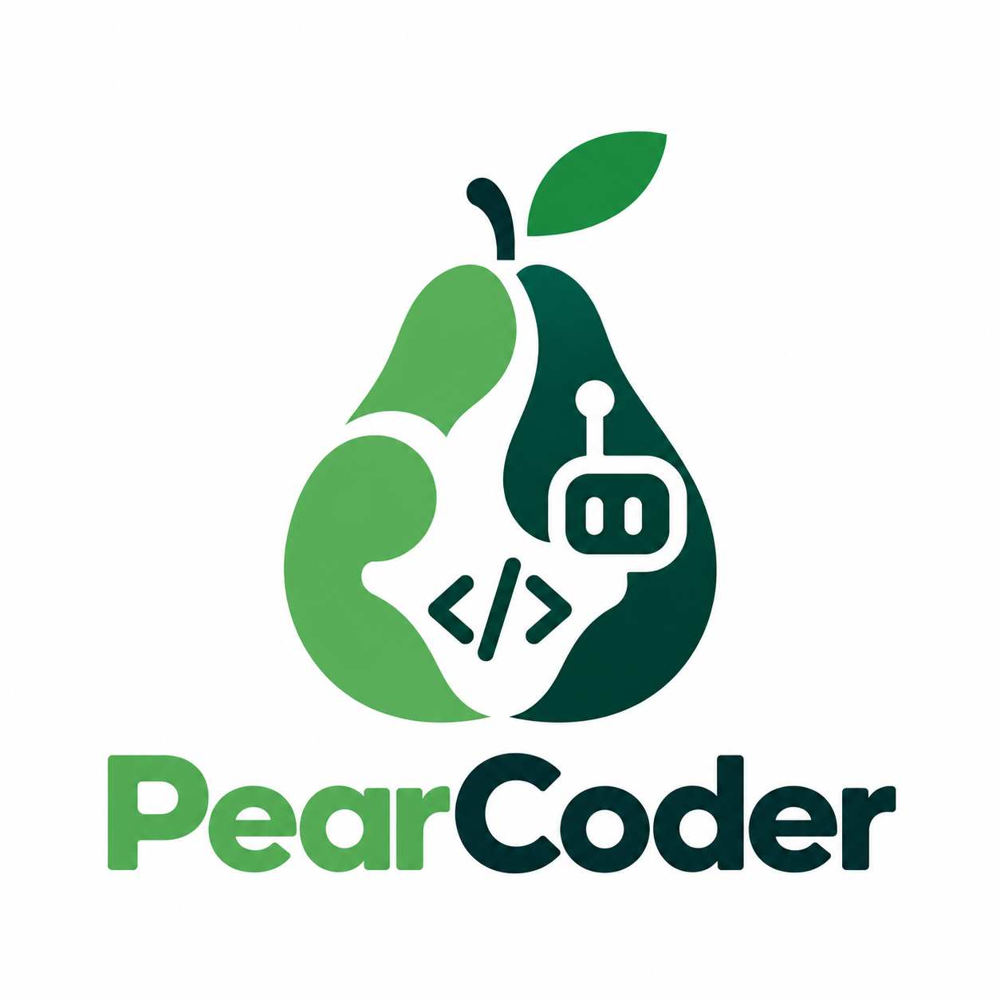
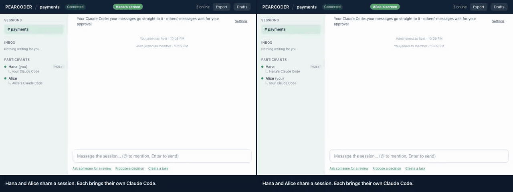

<p align="center">
  
</p>

<p align="center"><em>Where agents and humans have a tea party.</em></p>

<p align="center"><a href="https://www.npmjs.com/package/pearcoder"></a></p>

<p align="center">
  
</p>

<p align="center"><sub>Real UI, real Claude Code run (<code>/pearcoder:dev</code>). <a href="assets/demo/pearcoder-demo.mp4">MP4</a> · recorded with <code>e2e/demo/record.mjs</code></sub></p>

Collaboration sessions for developers and their AI coding agents. Pearcoder is local-first: each developer keeps using their own agent (Claude Code or Codex) with their own subscription. The team gets a shared session for discussion, review requests, findings, decisions, tasks and pushed branches. Each agent reads it, and writes into it, only through MCP.

**Nobody can run your agent but you, and that includes Pearcoder.** Colleagues can ask, discuss, and share. Your agent only touches Pearcoder when you ask it to, and nothing it writes leaves your machine until you approve it.

> Status: early release (0.5). Feedback welcome on [X](https://x.com/pearcoder) or [LinkedIn](https://www.linkedin.com/company/pearcoder).

## Get started in 5 minutes

You need [Node.js](https://nodejs.org) 22.13 or newer (check with `node --version`). Every person installs Pearcoder on their own machine:

```bash
npm install -g pearcoder
pearcoder whoami --set-name "Your Name"
```

### 1. Start a session (one person)

```bash
pearcoder host --name auth-review --lan
```

This prints an invitation (`pc1_…`) and opens the web UI. Send the invitation privately (Slack DM, for example). It works once and expires in 24 hours. Leave the command running: the session lasts until you press Ctrl-C.

Teammates must be on the same network, or the same Tailscale or WireGuard network. To try it alone on one machine, leave out `--lan`.

### 2. Join (everyone else)

```bash
pearcoder join pc1_…
pearcoder ui
```

`pearcoder ui` opens the session in your browser. Chat, review requests, findings and decisions all happen there. Type `@` to mention someone or someone's agent (`@Alice's Claude Code`): it lands in their inbox. Everything also works from the terminal: `pearcoder say "@Alice hi"`, `pearcoder watch`.

### 3. Let your own agent help review (optional)

Run this once to connect your Claude Code (or `--agent codex` for Codex):

```bash
pearcoder attach --agent claude
```

Then the review loop:

1. **Ask for a review.** In the UI, use "Ask someone for a review" and pick a person, or their agent ("Alice's Claude Code"). You can pick your own agent too. From the terminal:

   ```bash
   pearcoder share --pr 42                                  # or: pearcoder share spec.md --objective "Find races"
   pearcoder request --to Alice --package latest "Review the token rotation"
   pearcoder request --to Alice --for-agent claude "Review the token rotation"   # address her Claude Code
   ```

2. **Review with your agent.** Alice sees the request in her inbox (web UI or `pearcoder inbox`), opens Claude Code in the repository and types `/pearcoder:review`. With no id it takes her oldest open request. Her agent reads the request and the code and saves its findings as **private drafts**. It can't run commands, edit files or post anything.
3. **Publish.** Alice checks the drafts in the UI's Drafts panel (or with `pearcoder drafts`), edits them, and publishes the ones she agrees with.
4. **Decide and keep the result:**

   ```bash
   pearcoder findings                       # what was found, and what is still open
   pearcoder resolve <id> fixed             # short ids from the listings work
   pearcoder export --out review.md         # the consolidated review: findings, decisions, action items
   pearcoder github-review 42               # preview the findings as one GitHub PR review; add --post to post it
   ```

Want your agent to keep up on its own? Run `/pearcoder:listen` in Claude Code. While it runs, it drafts a finding for each new review request and an answer for each `@` mention of your agent. A mention can ask for work: `@Hana's Claude Code review PR 42`, `… the changes in feat/retry against main`, or `… src/token.ts`. `/pearcoder:listen once` handles what's waiting and stops. Without the listener, answer a mention yourself with `/pearcoder:discuss <id>` (your agent drafts it) or `pearcoder say --reply <id> "…"`.

Your agent has two auto modes per session (the UI's agent bar, or `pearcoder agent auto mine|others on|off`):

- **Mine**, on by default: your own messages and tasks go straight to your agent, and Pearcoder sends its answers after a secret scan.
- **Others**, off by default: other people's mentions, requests and tasks wait for you. Approve one, decline it, or rewrite it and approve your version (`pearcoder agent allow <id> --text "…"`). Your agent reads your version, and the session only sees "approved with edits". Turning it on lets anyone in the session make your agent answer unseen; the banner says so.

### Build together

Tasks say who does what: `pearcoder task "Retry on 503" --to Hana`, or `--to me --agent claude` to give it to your own agent (also in the UI: "Create a task"). Run `/pearcoder:dev` in Claude Code and your agent works on your own items: what you @mention it with, tasks you gave it, or someone's item you rewrote and approved. It edits the repository and pushes a branch through `git_commit_push`. That tool never pushes `main`, `master`, the default branch or branches you protect. It never forces, runs with git hooks off, and refuses secrets and oversized changes. The session then sees "your agent pushed `pearcoder/retry` @ `abc1234`". Code itself never goes through Pearcoder: people fetch and review the commit with git, as with any colleague's branch. Everyone sees what each agent is doing (waiting for its owner, working, done), never what it reads or writes. `pearcoder agent stop <id>` (or Stop in the UI) ends a run's work on an item.

Nobody's agent ever starts because someone else asked. Requests and mentions only show up in people's inboxes.

### Handy to know

- `pearcoder --help` lists every command. Every command takes `--json`.
- `pearcoder host --name auth-review --persist` keeps the session across restarts. Continue it later with `pearcoder host --resume auth-review`.
- `pearcoder doctor` checks your setup. `pearcoder status` lists your sessions; `pearcoder forget <name>` removes one that ended.
- **Upgrading:** `npm install -g pearcoder`, then `pearcoder attach --agent claude` again so Claude Code gets new commands.
- Your device key stays in `~/.pearcoder/` and never leaves your machine. Keep the web UI link private: it lets the browser act as you.
- Full walkthrough: [docs/quickstart.md](docs/quickstart.md). Security model: [docs/threat-model.md](docs/threat-model.md).

## Run from source

```bash
pnpm install && pnpm build
alias pearcoder="node $PWD/packages/cli/dist/pearcoder.mjs"   # the same bundle npm ships
```

## Repository layout

| Package | License | Purpose |
|---------|---------|---------|
| `packages/protocol` | Apache-2.0 | Event envelope, event types, schemas |
| `packages/core` | FSL-1.1-ALv2 | Session engine |
| `packages/server` | FSL-1.1-ALv2 | HTTP and WebSocket session server, LAN TLS |
| `packages/client` | FSL-1.1-ALv2 | Connection to a session host: join, login, live stream, reconnect |
| `packages/bridge` | FSL-1.1-ALv2 | Local node: owner-only API and web UI; later inbox, drafts, approvals |
| `packages/mcp` | FSL-1.1-ALv2 | Pull-only MCP server for your own agent |
| `packages/cli` | FSL-1.1-ALv2 | The `pearcoder` command |
| `packages/web` | FSL-1.1-ALv2 | Web UI |

See [LICENSE.md](LICENSE.md) for what each license allows.

## Development

Requires Node 24 (`nvm use`) and pnpm 12.

```bash
pnpm install
pnpm lint && pnpm typecheck && pnpm test
pnpm build
```

Read [CONTRIBUTING.md](CONTRIBUTING.md) and [docs/invariants.md](docs/invariants.md) before contributing; they apply to humans and coding agents alike. Security issues: see [SECURITY.md](SECURITY.md).

## Links

- X: https://x.com/pearcoder
- LinkedIn: https://www.linkedin.com/company/pearcoder
- npm: https://www.npmjs.com/package/pearcoder
